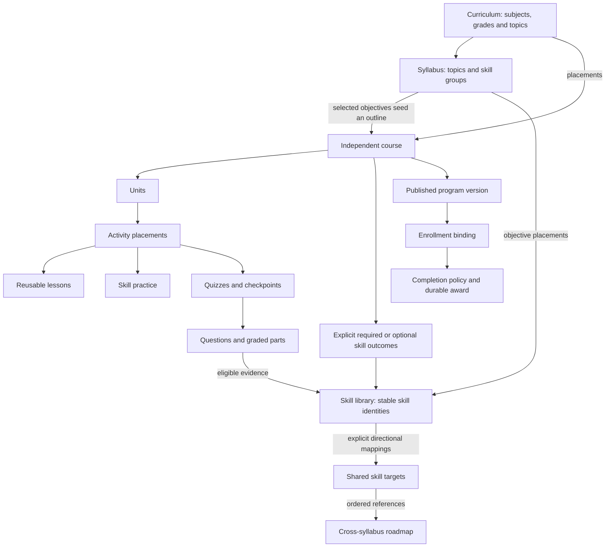

# OhMyLMS Learning Architecture

Reviewed against authored source on 1 November 2026. This is the authoritative product and learning-model reference. [App architecture](ARCHITECTURE.md) covers software boundaries; the linked API and testing documents retain their specialized contracts. **Intent**, **current behavior**, and **compatibility** below are deliberately distinct. This review did not inspect a live database or change application behavior.

## Product intent

OhMyLMS supports content-based courses comparable to a GCSE or A-level textbook: an understandable sequence of units, explanations, examples, lessons, practice and assessments. Shared skills connect teaching and assessment underneath that content. A course need not become a bare list of skills, and reading a lesson does not prove mastery.

Syllabuses describe what should be learned, organized by topics, levels/grades and objective groups. Authors should be able to select relevant topics and skills, generate an independent course outline, and develop its teaching material instead of manually recreating every chapter. The generated outline is a starting point, not completed instruction.

Shared skills also support comparison and roadmaps across sources such as Digital SAT and Cambridge IGCSE Mathematics. Overlap should be visible while distinct wording, scope, level, version and assessment requirements remain intact. Similar titles do not establish equivalence. Neither a mapping nor a roadmap promises fully adaptive sequencing or automatic exam credit.

## Entities and relationships

Arrows describe references or generation, not exclusive ownership. A syllabus skill group is an objective grouping; it is not a lesson post or a required course folder.

| Concept | Representation and boundary |
| --- | --- |
| Curriculum | Typed hierarchy in `Curriculum/Items`, with content linked through `Links` and course placement through `Placement`. A course can have multiple placements. Subject/grade classification is not evidence of skill attainment. |
| Syllabus | A curriculum item flagged as a syllabus, nested topics, ordered skill groups and skill placements. Codes, source versions and objective text preserve source context. |
| Skill | An `ohmylms_skill` taxonomy term with stable identity, objective/description, classifications, resource links and prerequisite relationships. A specific syllabus objective and a shared mapping target may be distinct terms. |
| Roadmap | Ordered skill references and selected source relationships for planning across syllabuses. It does not itself enroll learners or grant course access. |
| Course | Existing course post, curriculum placements, access/enrollment settings and learning program. Its teaching sequence can be independent of its syllabus. |
| Unit | Existing chapter record and course relationship; public chapter identifiers and class names remain unchanged. |
| Activity placement | Program identity, resource or skill reference, unit, order and completion configuration. A placement is separate from the resource it points to. |
| Lesson | Reusable WordPress lesson post containing teaching content, including block content and supported media/settings. |
| Assessment | Reusable quiz/assignment records and question contracts; quiz, unit-test and course-challenge styles have placement rules. |
| Outcome | A selected skill, target level and required/optional flag in a course program. Association alone does not create this requirement. |
| Program/enrollment | Versioned requirements and outline metadata, an enrollment's assigned version, evaluated progress and a durable completion award. |
| Course bundle | Curated ordered courses/curriculum members that learners can follow. Following is separate from enrollment, access and completion. |

### Units, lesson groups and activities

The earlier target was course → unit → lesson group → activity. **Current behavior** flattens retired lesson folders into units: block lessons are activities directly inside a unit. The learner overview and player use that flattened order. Historical programs can still name groups; compatibility fields and old lesson-group URL redirects preserve existing references. Do not recreate lesson groups as a new required container or confuse them with syllabus skill groups.

The current typed outline supports adding, moving, ordering and detaching reusable resources. Existing practice and skill data survive its payloads. A reading lesson is content, not a container for other activities. Unit tests and course challenges retain assessment-style validation. See [course authoring](api/course-authoring.md), [structure contract](COURSE-STRUCTURE-CONTRACT.md) and [learner journey](LEARNER-LESSON-JOURNEY.md).

## Curriculum, syllabuses and independent course generation

Syllabus structure is syllabus → topic (optionally nested) → skill group → skill. A skill can be placed once per syllabus and reused across syllabuses. Removing a placement does not delete the library term or its evidence. Creating similarly named objectives does not merge them automatically.

Full objective wording is separate from the short title. Its read fallback is explicit objective metadata, then legacy description, then name. English/Mongolian objective translations can coexist with older title/description translations. The legacy CSV columns still carry titles and descriptions, not the additive full-objective field.

**Implemented generation service:** `CourseFromSyllabus` accepts a reviewed selection of topics/skills and creates an independent draft course. Selected topic folders become units; selected skill groups seed draft block lessons with empty bodies. Skill IDs remain shared, optional outcomes and placement skill links are created, and source objective references are retained. No questions, practice activities or explanatory content are invented. New course/unit/lesson/placement identities belong to the generated course; later syllabus rearrangement does not rename or reorder them. See [generation API and tests](COURSE-FROM-SYLLABUS.md).

**Current UI gap:** this checkout's typed app has no `from-syllabus` client entry. The backend capability must not be advertised as an available current creation dialog merely because the recovered editor once exposed it. Restoring a unified selection/review/create workflow remains implementation work.

**Compatibility:** `SyllabusCourse` also supports a different, mirrored mode: a syllabus-owned course whose chapters/outcomes follow syllabus groups/skills. The typed syllabus commands still expose creation/synchronization. This is not independent generation and should not be the default product mental model. Existing mirrored courses are not silently converted. Synchronization errors can leave the syllabus edit saved while reporting a separate course error. A mirrored course meets the same publication rules as any course: it needs at least one completion requirement (and a required skill outcome unless its mode is traditional), because an empty requirement set could never be completed. A reviewed conversion preserving IDs, placements and learner history remains future work.

Course syllabus selection, source objective references, curriculum placement and program outcomes are separate data. `_ohmylms_course_objectives` stores source/term pairs; these references express alignment, not mastery or completion. The same skill can have more than one source context. See [objective API](COURSE-OBJECTIVES.md) and [syllabus authoring](api/syllabus-authoring.md).

## Skills, prerequisites and cross-syllabus roadmaps

Skills are subject- and source-agnostic: subject profiles supply classifications, and provenance/review records distinguish imported or suggested skills from reviewed ones. AI suggestions require review; they do not replace syllabus requirements. Reuse a skill when the measurable ability is the same. Preserve distinct source objectives when scope or expectations differ; explicitly map them to a shared target rather than merging by name. Catalogue parentage organizes browsing. Prerequisites describe learning dependencies separately from that hierarchy; the skill services use them for recommendations. Prerequisite-aware recommendations and adaptive question selection do not establish an automatically generated personalized curriculum.

| Mapping | Meaning |
| --- | --- |
| Equivalent | Eligible for pooled shared evidence under existing mapping rules. Source evidence and requirements remain identifiable. |
| Source broader / source narrower | Directional scope relationship; descriptive, not automatic evidence transfer. |
| Related | Useful connection without equivalence or pooled mastery. |
| Required together | Combined coverage of at least two objectives from one source; not automatic mastery, evidence pooling or resource inheritance. |

Roadmaps reference skills in a chosen learning order and name their sources. Changing sources does not automatically add steps or erase connections. Comparison identifies mapped overlap, source-only coverage and unmapped objectives. Unmapped or unassessed does not mean failed. Source version omissions must remain visible; mapping Digital SAT and IGCSE does not certify that imported wording matches a particular official edition.

Direct skill mastery, mapping coverage and pooled shared mastery are different measures. Bundle comparison pools equivalent evidence on read, deduplicating graded parts; it does not write another course's completion or grant access. Course evidence reuse is controlled separately by the program's evidence policy. See [shared-skill contracts](SHARED-SKILLS.md), [curriculum and bundles](CURRICULUM-BUNDLES.md), and [skill workspace API](api/skill-workspace.md).

## Teaching links, practice and assessment evidence

| Relationship | What it establishes | What it does not establish |
| --- | --- | --- |
| Association / alignment | A taxonomy link, syllabus reference or placement skill tag relates records. | Required completion, reviewed instructional suitability or mastery. |
| Teaches | A lesson is linked as teaching material for a skill. | Reading that lesson proves independent performance. |
| Practices | A practice activity selects a skill and an authorized question pool. | Finishing a session meets a course outcome. |
| Assesses | Eligible questions/graded parts map to a skill and produce evidence through assessment services. | A quiz-level tag alone provides question coverage. |
| Required outcome | The program explicitly requires the skill at its target. | Every associated skill is required. |

Planned quiz skill links express author intent. Actual assessment coverage must inspect saved questions: primary mappings count as assessment coverage; supporting mappings and quiz tags are not substitutes. Learner evidence comes from grading and the versioned assessment contract, not from the outline inspector. Hints, retries, independence, question families, review and pending/manual evaluation affect whether evidence qualifies. Do not infer proficiency from a raw correct-answer count alone.

Practice eligibility respects approval, secure-exam exclusions, supported grading, configured banks and learner access. Missing eligible questions should produce an unavailable state. Required outcome question/family gaps can block publication; optional practice gaps and teaching guidance are advisory. Existing question extensions, grading writers and assessment snapshots remain authoritative; see [assessment engine](ASSESSMENT-ENGINE.md) and [practice guidance](LESSON-PRACTICE-GUIDANCE.md).

## Author workflow and save boundaries

The intended unified workflow is: choose syllabus objectives → generate an independent outline → develop lessons → connect practice and quizzes → review coverage and requirements → make the course available → inspect learner progress. Current implementation covers these through multiple services/screens; it does not yet provide every step in one restored editor.

1. Organize curriculum and syllabus objectives, reviewing codes, versions and mappings. Use reviewed CSV import where appropriate.
2. Create a course and arrange units/activities. Independent syllabus generation is implemented server-side; use its documented reviewed API until the typed UI exposes it.
3. Write lesson content and configure quizzes/questions in their resource editors. Placing a resource does not author its body. Resource creation/saves and outline placement are separate operations.
4. Select learning mode, required activities/checkpoints and skill targets. Distinguish planned connections from actual question coverage. Configure allowed pools and evidence reuse deliberately.
5. Save the outline draft. Resolve conflicts by reloading/reviewing, not by silently overwriting. Resource and organization writes have their own boundaries.
6. In the current typed app, preview the saved course and use its reviewed Publish panel with the required administrative capability. Resources must already be published. Publication makes the course and saved program available to new enrollments; existing learners retain their assigned version.
7. Check the enrolled learner experience and reports. Access, pricing and enrollment rules still apply after publication.

### Current behavior versus retained activation

The current client `CourseEditorPage` says **Save outline draft** and its tests explicitly assert that payloads omit `activate`. `PublicationPanel` performs the separate publication workflow. Older documentation describing a single **Save course** action with immediate activation belongs to the recovered editor.

The backend `OutlineEditor::activate()` still exists for explicit `activate: true` callers: within the guarded transaction it can publish eligible draft course/resources, validate the program and migrate unfinished enrollments. Completed history remains protected. This retained API behavior must not be confused with current UI behavior. Legacy structure publication and typed authoring publication also differ in whether they publish the course post; consult their contracts before integrating.

Published programs freeze requirements and unit metadata/order, not reusable lesson bodies or quiz definitions. Native chapter records remain authoring records. Enrollment selection, legacy baselines and explicit upgrades protect older outlines. Editing a shared resource can affect every place using it even when those places have older program versions. See [publication contract](COURSE-OUTLINE-PUBLISHING.md) and [course settings API](api/course-settings.md).

### Unified workspace intent and discrepancy

The syllabus/roadmap experience is one outline/detail workspace. Old mind-map, spreadsheet and separate visual-editor views are not the current product direction and are not recommended authoring steps here. `SyllabusPage.tsx` renders only the outline: the `MindMap` and `SpreadsheetView` layouts were removed on 1 November 2026, and an old `?layout=` address opens the outline. The `sheet_edit` command remains for API compatibility.

## Learner journey, progress and completion

A learner discovers courses through curriculum/subject placement or curated bundles, obtains access/enrollment, opens a course overview, and follows units and activities. The focused player offers current-activity context, previous/next available activities and return-to-unit navigation. Active quizzes retain their isolated assessment navigation. Navigation itself never marks work complete.

Reading/video completion uses the existing authorized completion writer. Practice and quiz results go through assessment/evidence writers. Practice guidance considers unmet targets, due reviews and eligible pools, then continues through the authored unit sequence. Course Continue learning uses the learning-path decision and locks. These are concrete recommendations, not a claim of fully adaptive course construction.

Keep the measures separate:

- **Activity progress:** visible completed resources; the learner overview can include optional resources and excludes practice from its activity denominator.
- **Skill progress:** evaluated skill levels relative to selected targets. Proficient is not enough when the required target is Mastered.
- **Checkpoint results:** graded pass conditions, including pending/manual grading where applicable.
- **Course completion:** the explicit AND of published required activities, skill outcomes and checkpoints, evaluated by `CompletionPolicy`. Optional requirements do not enter its required denominators; an empty requirement set cannot complete the course.

Traditional, skill-based and blended modes provide presentation/defaults; they do not silently erase explicit requirements. Practice session length is not a completion requirement. Existing evidence may qualify across courses when the program permits it; course-only evidence and age limits narrow that policy. A completion award is durable and is not revoked merely because a skill later needs review. Compatibility percentage widgets use the least-complete required dimension and reserve 100 for completion, rather than averaging unrelated measures.

Lesson content can be reused across courses; course completion remains enrollment-specific. Quiz/assignment attempts and checkpoint status may be shared when the same assessment is reused. Authors needing distinct assessment records should not assume a new placement creates them. Mastery or following a bundle never unlocks another paid/restricted course by itself.

## Source of truth and remaining work

| Area | Authored implementation to inspect |
| --- | --- |
| Curriculum / generation / mirroring | [CourseFromSyllabus](../includes/Curriculum/CourseFromSyllabus.php), [SyllabusCourse](../includes/Curriculum/SyllabusCourse.php), [Syllabus](../includes/Curriculum/Syllabus.php) |
| Outline persistence / activation | [OutlineEditor](../includes/Learning/OutlineEditor.php), [CourseProgram](../includes/Learning/CourseProgram.php), [CourseStructure](../includes/Learning/CourseStructure.php) |
| Current author screens | [CourseEditorPage](../assets/src/app/features/course-structure/CourseEditorPage.tsx), [PublicationPanel](../assets/src/app/features/course-structure/PublicationPanel.tsx), [SyllabusPage](../assets/src/app/features/syllabus/SyllabusPage.tsx) |
| Progress / recommendations | [CompletionPolicy](../includes/Learning/CompletionPolicy.php), [CourseOutline](../includes/Student/CourseOutline.php), [Recommendations](../includes/Skills/Recommendations.php) |

Remaining product/implementation reconciliation includes restoring independent generation in the typed authoring workflow and deciding how the unified save experience should use the existing activation service. Existing mirrored courses need an explicit transition rather than automatic conversion. Automatic mapping, comprehensive adaptive prerequisite sequencing and automatic examination-credit transfer are not promised by this architecture.

This reference replaces overlapping historical architecture/editor narratives. Specialized API, storage, compatibility and test contracts remain linked. Historical audit counts and old test totals are not current installation facts; their original records remain in Git history.
